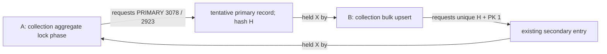

# Ingestion contention investigation

Evidence date: October 11, 2026. This document distinguishes decoded observations, controlled reproduction, code contracts, and remaining hypotheses. No application fix or production tuning was applied during this investigation.

## Findings that change the implementation order

The original deadlocks are more specific than "many writers update the same collection." One transaction holds a unique collection-hash record and waits on a different primary record containing the same hash. The competing transaction holds that primary record and waits on the unique record. The primary record's ID is outside the stable seeded collection set.

A separate tiny MariaDB 11.4.8 experiment reproduced this pattern with IDs and hashes aligned. The unhinted collection lock query chose a secondary-index scan and filesort. A control with a verified PRIMARY range plan and a control using individual primary-key equality lookups completed without the cycle. Thus opposite ID/hash order is not necessary for this reproduction. Testing the collection lock query's access path is now a smaller next candidate than introducing transaction-wide parent ownership.

This is a causal SQL reproduction, not a full PHP-service fix. It used a simplified parent schema, one observation per control, and no binaries, parts, crossposts, cleanup, or repair workers. The access path from the historical full-service run was not captured. We cannot state that all production deadlocks share this cause or that an index hint is sufficient for every workload.

## Evidence inventory and provenance

| Artifact | Purpose | Limits |
|---|---|---|
| [24-case baseline](performance/evidence/2026-10-11-ingestion-baseline.json) | Real storage code, initial correctness, throughput, retries, replay | Tiny cache-fit dataset; strict CPU caps; two repeats |
| [Baseline runtime](performance/evidence/2026-10-11-ingestion-environment.json) | Runtime images, architecture and resource limits | Native PHP differs from production mode/architecture; transaction isolation, durability and binlog settings were not captured in this inventory |
| [Case 8 snapshot](performance/evidence/2026-10-11-deadlock-case-8.txt) | Physical record and transaction edges | Latest deadlock after workers joined, not exception-time capture |
| [Case 21 snapshot](performance/evidence/2026-10-11-deadlock-case-21.txt) | Independent repeat of the same edge pattern | Same capture limitation |
| [Causal SQL probe](performance/evidence/2026-10-11-lock-causal-probe.json) | Submitted statements, barriers, first observed wait, plans, errors, final rows | Simplified schema, no service-level accounting tests |
| [First probe attempt summary](performance/evidence/2026-10-11-lock-probe-first-attempt.json) | Preserves the initial harness timeout honestly | Partial run; excluded from complete control comparison |

The authoritative tiny probe ran 18:04:02–18:04:11 America/Chicago (23:04:02–23:04:11 UTC), on the separate host using the already cached MariaDB 11.4.8 image. Limits: 1 CPU, 512 MiB memory, 64 MiB pool, disposable memory-backed database, network disabled, no published ports or production mounts/configuration. Its own container was removed successfully. The preceding attempt ran 18:03:15–18:03:37 and timed out while an observer issued an equality-query EXPLAIN during live transactions. The corrected protocol obtains plans before opening worker transactions. That timeout is a harness observation; this investigation does not assign its engine-level cause.

The nine Binaries service files in the frozen bundle match this checkout byte for byte. Release processing and creation in the frozen bundle differ from this checkout. References below to those writers identify frozen versus checkout locations explicitly; they do not imply those writers participated in the isolated baseline.

## Transaction sequence and lifetime

| Step | Code reference | State and lock implications |
|---:|---|---|
| 1 | `HeaderStorageService.php:60–109` | Validate headers and split header chunks. Earlier chunks can commit even if a later one fails. |
| 2 | `HeaderStorageService.php:178–199` | Reset all three handlers, exceptions, touched IDs and pending parts; make a fresh transaction/noise marker. |
| 3 | `HeaderStorageTransaction.php:48–59` | Top-level MariaDB/MySQL attempts use READ COMMITTED. Nested transactions do not get this override. |
| 4 | `CollectionHandler.php:148–332` | Normalize collection identity; SHA-1 cleaner name plus totalfiles; plain prefetch; hash-sorted upsert; resolve missing IDs. Existing prefetched rows still enter the write statement. |
| 5 | `CollectionHandler.php:428–460` | Insert crosspost membership in `(collection ID, group)` order. A duplicate-only header can still require a new membership. |
| 6 | `BinaryHandler.php:102–218` | Resolve/upsert binaries in `(collection ID, binary hash)` order; duplicate `totalparts` can grow. |
| 7 | `HeaderStorageService.php:315–339`; `PartHandler.php:114–199` | Globally sort part stream, flush deduplicated SQL batches, INSERT IGNORE against `(binary ID, partnumber)`. |
| 8 | `BinaryHandler.php:444–482` | Lock touched binaries by ID, read authoritative parts without locking the aggregate scan, CASE-update binary counters. |
| 9 | `CollectionHandler.php:656–707` | Lock collections by ID, read binary aggregates, CASE-update collection size/last-seen and guarded readiness. The recorded waiting statement is this lock acquisition, before aggregate reading. |
| 10 | `HeaderStorageTransaction.php:80–124` | Commit or roll back the entire attempt. InnoDB uses rollback only; manual descendant cleanup is SQLite-only. |
| 11 | `HeaderStorageService.php:118–150,233–274` | Retry eligible errors with fresh state; retain final failed article numbers when the budget is exhausted. |

Statement bounds are not transaction lock bounds. A 500-row SQL limit prevents huge individual statements; locks acquired earlier can remain while later parts and aggregates are processed, until commit/rollback. Collection, binary, parts, and aggregate phases each sort different keys. Those local sorts do not prove a common physical-resource order across the entire transaction.

### Retry budget and error reporting

There are ten total attempts, not ten retries after the first attempt. Scheduled backoff after failures 1–9 is `100 * attempt + random(0,25)` milliseconds: 4.5–4.725 seconds total before the final attempt, plus actual statement/lock time. The observed failed-case p95 service batches around five seconds are consistent with retry-budget cost; they do not measure a single SQL statement taking five seconds.

Retryable cases include serialization/lock errors, driver 1020/1205/1213, recognized lock messages, SQLite locking, and missing-parent 1452. Failed retryable attempts remove provisional failure bookkeeping before retry; final rollback reports the chunk's article numbers, including duplicates. A normal worker exit can therefore coexist with incomplete initial storage: the API returned failures and the worker handled them. Child exit zero alone is not a correctness gate.

`begin()` is outside the attempt's try block. That boundary merits a future isolated failure test but is not evidence for the captured 1213 deadlocks.

## Decode the original two-transaction graph

Let H be `14be5b91894072302b613a86d46121bfd42c1db8`. Reconstructing the fixture gives `SHA1("Bench.Collection.164") = H`: collection ordinal 16, four expected files. It is the lowest hash of the 32 seeded collections; the secondary record explicitly pairs it with seeded primary ID 1.

| Decoded property | Case 8 | Case 21 |
|---|---:|---:|
| Collection-lock transaction | 2664 | 8554 |
| Bulk-upsert transaction | 2665 | 8555 |
| Collection-lock query's requested PRIMARY ID | 3078 | 2923 |
| PRIMARY location | space 58, page 3, heap 37 | space 136, page 3, heap 37 |
| Unique-secondary entry | H + primary ID 1 | H + primary ID 1 |
| Secondary location | page 4, heap 2 | page 4, heap 2 |
| PRIMARY wait/held mode | X record, no gap | X record, no gap |
| Secondary wait/held mode | X ordinary | X ordinary |
| Selected victim | Collection-lock transaction | Collection-lock transaction |

The waiting and conflicting dumps match on each physical resource. The PRIMARY payload also carries the upsert transaction's system transaction ID, confirming its owner. Its subject/xref reconstructs a fixture header: case 8 corresponds to article 105808, file 2, part 46/80; case 21 to article 101776, file 4, part 14/80. These details identify synthetic input, not the exact failed worker or attempt.

The stable unique entry points to ID 1 while the competing primary record uses ID 3078/2923. This is not reciprocal locking of two ordinary committed collection rows. Neither edge shows a shared-lock holder, so these snapshots do not establish an S-to-X upgrade. They also explicitly show the PRIMARY wait as record-only, which rules out describing that edge as a generic gap-lock wait.

The saved status is the latest deadlock after workers join. It can characterize a cycle that occurred in a failing case, but cannot be assigned to a particular exhausted chunk without exception-time capture and worker/transaction identifiers.

## Controlled reproduction: plan-sensitive locking footprint

The tiny probe used 32 committed parents, IDs 1–32 assigned in sorted hash order, READ COMMITTED, and two live worker clients plus observer commands. It deliberately removes the need for opposite ID/hash mapping.

1. Seed the parents; obtain EXPLAIN before worker transactions.
2. Worker A starts a transaction and completes a no-op duplicate upsert for all seeded parents, retaining locks.
3. Worker B starts a transaction and submits a duplicate insert of the first hash with `ON DUPLICATE KEY UPDATE id=LAST_INSERT_ID(id)`.
4. The observer confirms B waits on A's unique collection-hash lock. Submission alone does not count as this barrier.
5. A submits the collection lock query for IDs 1–32, or the selected control query.
6. Record statement result, latest deadlock if produced, commit/rollback handling, and survivor outcome. Verify 32 final committed rows; join both clients; remove the container.

| Control | Observed EXPLAIN | Outcome in completed probe |
|---|---|---|
| Unhinted `id IN (1..32) ORDER BY id FOR UPDATE` | `access_type=index`, collectionhash index, `using_index=true`, filesort | A reports 1213; cycle reproduces |
| Same logical ID set, `FORCE INDEX(PRIMARY)` | `access_type=range`, PRIMARY | A completes; B proceeds after release |
| 32 individual `WHERE id=N FOR UPDATE` statements | Equality-query control reports `const`, PRIMARY | A completes; B proceeds after release |

The reproduced PRIMARY conflict is ID 65, outside the requested 1–32 set. Its hash equals the secondary entry pointing to ID 1. This is consistent with a tentative auto-increment insert before unique-secondary conflict checking. The effective lock acquisition can encounter a primary record outside the logical result set. The unhinted EXPLAIN describes a covering secondary scan plus sort; it does **not** say `ALL`. Do not relabel it as a proven full-table scan.

EXPLAIN's `using_index` is not a guarantee of primary-lock avoidance during a locking read. The captured PRIMARY edge is direct evidence of a wider effective locking footprint in this schedule. The precise engine route from the secondary plan to that tentative record still deserves tagged-source tracing and an exact-schema regression.

The tiny snapshot labels SELECT transaction 24 as (1) and duplicate-insert transaction 25 as (2), yet prints rollback (2), while the SELECT client receives 1213 and the duplicate client succeeds. Its later transaction list also retains transaction 25. This is an unresolved inconsistency between the snapshot victim label and client outcomes. Preserve it explicitly; neither relabel transactions nor assign the victim solely from the rollback number. The client statement outcomes and matched wait edges support the bounded reproduction independently of that label.

Plans are preflight EXPLAINs, not captured plans of the executing blocked query. The protocol's `deadlock` flag checks 1213 in the SELECT client's output, not every possible SQL error from both clients; positive control outputs also show all requested IDs and final counts. Future regression tooling must assert every statement outcome explicitly. The report records the image tag rather than an in-container server-version query; a separate preflight inspect verified the cached image identity, but the run command used the tag. These provenance limitations are retained in the archived metadata.

### Tagged source supports the mechanics

Use MariaDB's exact `mariadb-11.4.8` tag rather than a moving branch:

- [Insertion index sequence](https://github.com/MariaDB/server/blob/mariadb-11.4.8/storage/innobase/row/row0ins.cc#L3713-L3747): index insertion begins at the first table index and proceeds to subsequent indexes.
- [Secondary duplicate checking](https://github.com/MariaDB/server/blob/mariadb-11.4.8/storage/innobase/row/row0ins.cc#L2122-L2150): ODKU uses exclusive ordinary locks during duplicate checking.
- [Locking reads](https://github.com/MariaDB/server/blob/mariadb-11.4.8/storage/innobase/row/row0sel.cc#L5154-L5167): READ COMMITTED chooses record-only locking; later code requests the lock before pushed condition evaluation.
- [Post-read unlocking](https://github.com/MariaDB/server/blob/mariadb-11.4.8/storage/innobase/handler/ha_innodb.cc#L8776-L8800): the ability to release a nonmatching record after reading does not guarantee avoiding a wait before that read.

Source establishes that the mechanism is possible; the controlled fixture establishes occurrence under its schedule. Neither replaces a captured plan and source-matched full-service regression for the original application workload.

## Correctness contracts that constrain any change

### Stored parts and duplicates

Parts are authoritative. Binary `currentparts` equals stored part count; `partsize` equals stored size sum; `partcheck` reflects completeness against expected `totalparts`. Incoming duplicates do not overwrite committed size, message ID, or article number.

Within one pending flush, duplicate selection prefers a nonempty message ID, then larger size, then lower article number. Across flushes/workers/replays, the first stored primary-key row wins. Document those scopes rather than claiming one global maximum-size selection policy.

After a partially successful INSERT IGNORE, current code checks persisted key existence, not byte-for-byte equality with the attempted row. Its inserted-article bookkeeping records every inserted number only when the whole deduplicated batch inserted; a mixed batch does not yield exact per-row insertion identity. That metadata cannot drive exact incremental aggregate deltas.

### Parent creation bookkeeping

The handlers label parent IDs inserted when absent from prefetch, even if a concurrent worker won creation. These sets are absence-before-write bookkeeping, not proven creation ownership. InnoDB rollback makes current failure cleanup safe without deleting those IDs manually. An ownership or inserted-parent delta scheme must obtain stronger evidence.

### Collection readiness and lifecycle

Collection filesize is derived from binary sizes. Readiness requires a positive expected file count, actual binary count equal to expected or expected+1, and enough complete binaries. Ingestion promotes only allowed waiting states to Sized; it does not demote later lifecycle states.

Growing a binary's expected part count can reverse binary completeness. A future complete-file delta must handle both directions and concurrent final parts, not only increment on an apparent first completion. Replay-only chunks also still require membership or last-seen updates.

### Reconciliation and zero-child repair

Current rescans can repair derived totals from authoritative children. MySQL ingestion refresh skips empty grouped results, while release reconciliation can explicitly default missing children to zero. Incremental arithmetic preserves a pre-existing offset unless a separate repair contract remains.

Release binary repair guards old `currentparts` and `partsize`; collection repair guards old `filecheck`, `totalfiles`, and `filesize`. These avoid some stale overwrites but are not complete version stamps; unguarded-field changes or ABA changes can escape detection. Those are design constraints, not demonstrated causes of this fixture's deadlock.

### Other writers to inventory

| Writer | Frozen / checkout reference | Required interaction test |
|---|---|---|
| Release binary reconciliation | `ReleaseProcessingService.php:837–869` / `504–534` | Repair overlapping ingestion without double counting or stale overwrite |
| Release collection reconciliation | `876–963` / `543–630` | Readiness/size repair versus candidate locking/deltas |
| Release creation | `ReleaseCreationService.php:137–138` / `129–130` | Marking Inserted cannot be regressed by ingestion |
| Cleanup | `CollectionCleanupService.php:311–348`, matches | Cascade versus explicit child-first deletion, parent recreation and 1452 retries |
| Downtime compensation | `CollectionDowntimeCompensator.php:208,255` | Timestamp changes and lifecycle eligibility |
| Storage optimizer | `OptimizeCbpStorage.php:328–339,359–418` | Maintenance deduplication, identity changes, aggregate rebuild |

These paths did not run in the isolated ingestion benchmark. Their existence constrains a safe application change but must not be invoked as the explanation for that test's cycle.

## Separate remaining hypotheses

| Question | Present evidence | Next discriminating observation |
|---|---|---|
| Does access-path-sensitive locking reproduce the cycle? | Yes, simplified two-worker probe | Exact frozen schema and real handler regression |
| Is opposite ID/hash order necessary? | No, aligned reproduction deadlocks | Still test other multi-parent schedules for independent cycles |
| Is a committed neighboring secondary row necessary? | Not established | Bind requested sets and decode outside-set records separately |
| Does a PRIMARY range hint solve full ingestion? | One SQL control passes | Verify actual plans across cardinalities, statistics and large batches; all service invariants |
| Is early parent ownership needed? | Not yet established | Defer broad ownership design until access-path candidate is evaluated |
| Does CPU throttling explain throughput differences? | Historical caps are a confound | Independently vary app/DB CPU allowance and record throttling |
| Can RETURNING deltas replace rescans safely? | One insert semantics probe passes | Warning, rollback, mutation, readiness and repair matrix |
| Would larger buffers/redo fix this cycle? | No supporting evidence | Storage/checkpoint pressure experiment is a separate question |

## Smaller execution steps and stop conditions

### Work item A: turn the decoded graph into a regression

- [ ] Preserve exact frozen collections DDL and all seed hashes/IDs; include stable IDs 1–32 and a duplicate that generates a tentative out-of-set ID.
- [ ] Record each connection ID, attempt ID, submitted SQL/bindings, transaction ID, phase, and monotonic event number.
- [ ] Obtain EXPLAIN before opening the lock schedule; do not let observer queries silently become a blocker.
- [ ] Require B's observed secondary wait before issuing A's lock query. Report missing wait as harness-invalid/unconfirmed, not successful prevention.
- [ ] Capture error-time status and available wait graph immediately; decode both resource edges.
- [ ] Verify worker exits, survivor completion, transaction cleanup and final state. A marker emitted after SQL error is not proof that the preceding statement succeeded.

### Work item B: test the smallest access-path candidate

- [ ] Pin the actual handler's unhinted baseline plan and reproduce the cycle through the smallest faithful fixture.
- [ ] Test explicit PRIMARY access without changing upsert, retry, or aggregate arithmetic. Assert an observed range/equality plan rather than assuming a hint enforces it.
- [ ] Exercise 1, 2, 32 and bounded maximum touched-parent counts, sparse/dense ID sets, new parents, deletions, varied statistics, and competing binary/collection aggregation.
- [ ] Retain SQLite behavior and current application interfaces. Avoid adding a driver-specific hint to unsupported backends.
- [ ] Run the full correctness gates in the real PHP storage path, then a bounded natural-schedule screen. Barrier-controlled elapsed time is not a throughput result.
- [ ] Only then consider a current-head reviewed implementation and the larger acceptance matrix.

If the baseline cannot reproduce under the exact schema, compare plans and row statistics before changing the candidate. If the candidate changes which cycle occurs, capture the replacement edge and reject a blanket "deadlocks fixed" conclusion.

### Work item C: screen confounds independently

- [ ] Hold work fixed and compare historical CPU caps with app-only and DB-only relief; record `cpu.stat` throttling.
- [ ] Hold resources fixed and vary shared/disjoint/hot-skew parent ownership independently from duplicate percentage.
- [ ] Test retry dispersion separately from access-path changes, retaining the attempt and elapsed budgets.
- [ ] Build actual storage/checkpoint pressure before changing buffer or log sizing.

### Work item D: inserted-only deltas remain a later project

- [ ] Capture INSERT IGNORE diagnostics immediately, including whether warning storage was truncated; do not classify every missing returned row as a duplicate.
- [ ] Verify persisted returned sizes, trigger effects, failed statements, explicit rollback and winner rollback.
- [ ] Independently compare committed count/sum after insert/delete/correction/reassignment/recreation and stale-starting-counter cases.
- [ ] Preserve repair and crosspost/lifecycle contracts before removing any rescan.

## Report and statistical precision

Each experiment needs a manifest, events, statement outcomes/diagnostics, raw and decoded lock records, correctness states before/after replay, resource deltas, and a comparison summary. Use explicit classifications: reproduced, not reproduced, hypothesis not supported, correctness failed, harness invalid, performance inconclusive, or candidate passed declared scope.

Six independent pairs are an initial measurement budget, not a precision guarantee. Report pair identities and the chosen effect estimator, preferably log throughput ratios with an explicitly documented interval method and assumptions. Batches within a run are correlated. A p95 latency estimate and a 95% confidence interval are different concepts; very small batch samples make the former unstable.

The procedure's 5% useful throughput improvement and 10% regression budget are proposed project policy. They are not empirical constants or literature conclusions. Zero failures in a handful of controlled runs means none observed in that declared scope, not zero failure probability. Under independent identical Bernoulli assumptions, twelve zero-failure observations still allow an approximately 22% one-sided 95% upper failure-probability bound; workload-dependent observations need even more careful interpretation.

## Current conclusion

The investigation has moved from an index-name correlation to a decoded physical wait graph and an access-path-sensitive causal reproduction. The next application-level experiment should preserve the current transaction semantics and test the lock query's PRIMARY access, with the exact schema and correctness gates. Broad ownership, incremental aggregates, and database tuning remain separate, later questions.
